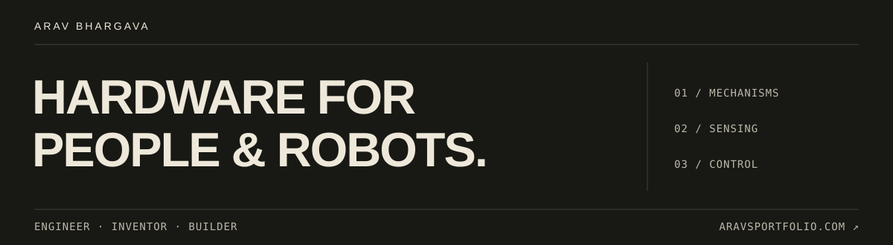
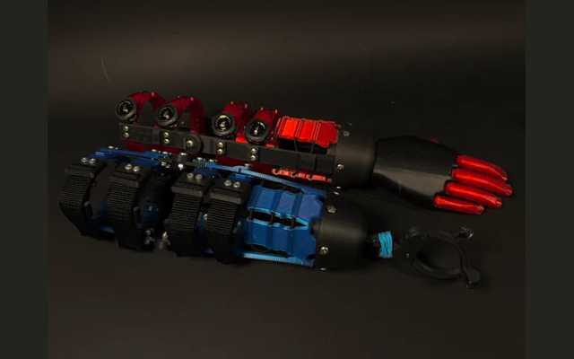
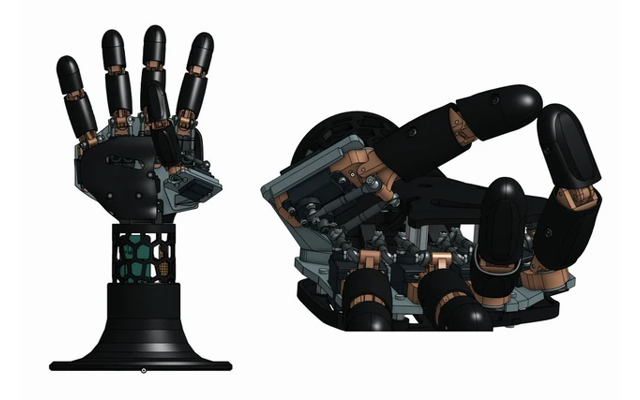

**EECS @ Harvard · Previously 1X Labs · Founder, [The Mobilis Project](https://themobilisproject.com)**

I build prosthetic interfaces, tactile sensors, and robots—across CAD, electronics, and software.

**I don’t post much on GitHub. [My portfolio is the best place to see what I’m building ↗](https://aravsportfolio.com)**

<table>
<tr>
<td width="50%" valign="top">

  
<strong>Mobilis · Adjustable prosthetic socket</strong> 
Patented. Built through 300 design iterations. Tested with 10 amputees.  
<a href="https://themobilisproject.com">The project ↗</a> · <a href="https://patentsgazette.uspto.gov/week10/OG/html/1532-2/US12245957-20250311.html">US 12,245,957 ↗</a>
</td>
<td width="50%" valign="top">

  
<strong>10-DOF robotic hand · CAD prototype</strong> 
Five fingers, ten servos, and an opposing thumb. Adapted from Pollen Robotics’ AmazingHand.  
<a href="https://aravsportfolio.com/?project=10-dof-robotic-hand">Explore the design ↗</a>
</td>
</tr>
</table>

### A few things here

| Project | What’s inside |
| :--- | :--- |
| [EMG → hand control](https://github.com/AravBhargava05/BionicArmNN) | Muscle-signal calibration and embedded control for a five-servo hand. |
| [Robot arm · SAC + HER](https://github.com/AravBhargava05/RobotArm_RL) | Goal-conditioned pick-and-place in Fetch simulation. |
| [Sign recognition](https://github.com/AravBhargava05/SignLanguageRecognition_CV) | Hand landmarks, a Random Forest, and live webcam inference. |
| [Q-learning vs SARSA](https://github.com/AravBhargava05/TabularRL_qlearn_vs_SARSA) | Exploration and learned behavior in CliffWalking and Taxi. |

[Portfolio](https://aravsportfolio.com) · [LinkedIn](https://www.linkedin.com/in/arav-bhargava/) · [Email](mailto:abhargava@college.harvard.edu)
